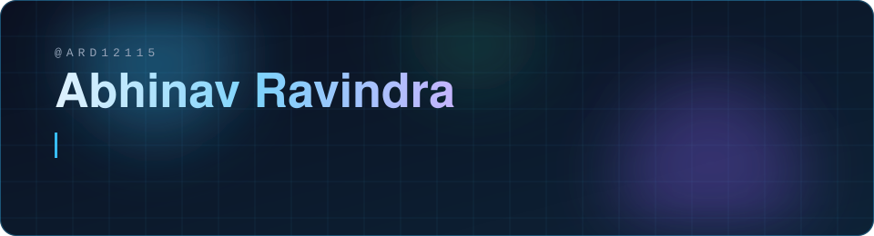
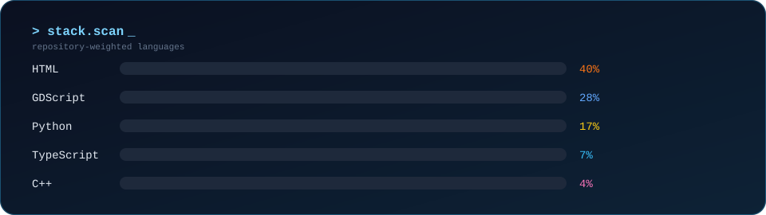
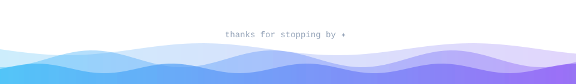

<div align="center">



</div>

<table width="100%">
<tr>
<td width="46%" align="center" valign="middle">



</td>
<td width="54%" valign="middle">

### `~/runtime`

<pre><code>ROLE     = Frontend / full-stack engineer
FOCUS    = AI · web · game dev
STACK    = Python · TypeScript · C++
           GDScript · Rust · CUDA
MOTTO    = Build useful things,
           learn in public
OPEN_TO  = collaboration · open source
STATUS   = shipping</code></pre>

</td>
</tr>
</table>


## 🚀 Projects

| Project | What it does | Stack |
|---|---|---|
| [**Recircle**](https://github.com/ARD12115/Recircle) | Recycling assistant: image-based waste sorting, a digital twin, and AI guidance | `Python` `Computer Vision` |
| [**JARVIS-Assistant**](https://github.com/ARD12115/JARVIS-Assistant) | Desktop AI assistant with multiple LLM backends, voice I/O, built-in tools, and persistent memory | `Python` `React` `TypeScript` `Rust` |
| [**GR-racer**](https://github.com/ARD12115/GR-racer) | Godot 4 arcade racer with generated roads, collisions, and procedural scenery | `Godot 4` `GDScript` |
| [**XeniaShaderOpt**](https://github.com/ARD12115/XeniaShaderOpt) | Xenia Canary optimizer: shader caching, CUDA-assisted hashing, frame pacing, audio sync | `C++` `CUDA` `Python` |


## 🛠️ Toolkit

```bash
ard12115@github:~$ toolbox --list
```

| | |
|---|---|
| **Languages** | `Python` · `TypeScript` · `JavaScript` · `C++` · `Rust` · `HTML` · `CSS` · `GDScript` · `CUDA` |
| **Frontend** | `React` · `Tailwind CSS` · `Vite` |
| **Game dev** | `Godot 4` |
| **Tools** | `Git` · `VS Code` · `Linux` |



<div align="center">

## 🤝 Open a channel

Got an idea, a bug report, or want to build something together? Issues and PRs are always open.

**[Browse my repositories →](https://github.com/ard12115?tab=repositories)**

</div>


