<div align="center">



</div>

<table width="100%">
<tr>
<td width="46%" align="center" valign="middle">



</td>
<td width="54%" valign="middle">

### `~/runtime`

<pre><code>ROLE     = Frontend / full-stack engineer
FOCUS    = AI · web · game dev · data pipelines
STACK    = Python · TypeScript · C++
           GDScript · Rust · CUDA · SQL
MOTTO    = Build useful things,
           learn in public
OPEN_TO  = collaboration · open source
STATUS   = shipping</code></pre>

</td>
</tr>
</table>


## 🚀 Projects

All public repositories, newest first.

| Project | What it does | Stack |
|---|---|---|
| [**PulseCart**](https://github.com/ARD12115/PulseCart) | Storefront demo where Postgres owns inventory, a transactional outbox publishes to Kafka, and OpenSearch serves fuzzy search; atomic checkout race demo | `TypeScript` `Python` `Next.js` `Kafka` `PostgreSQL` `OpenSearch` |
| [**Medical-Image-Enhancement**](https://github.com/ARD12115/Medical-Image-Enhancement-Project) | MedhaDrishti: brain & spine MRI enhancement (Autoencoder / ResNet18 transfer learning) and ROI segmentation for tumors, edema, lesions | `Python` `PyTorch` `OpenCV` |
| [**ReliefNet**](https://github.com/ARD12115/ReliefNet) | Real-time disaster-relief coordination: matches camp surplus with unmet demand and recommends delivery routes via OSRM | `React` `Node.js` `MongoDB` `Socket.IO` |
| [**Anuvada**](https://github.com/ARD12115/Anuvada-Kannada_English_Translator) | Kannada ↔ English translator for text, speech, and signboards (OCR + voice), built at CSE-HackSpark 2026 | `Python` `Streamlit` `Tesseract` |
| [**SkillMatch**](https://github.com/ARD12115/Skillmatch) | Resume screening: pick a target role, get a match score plus the skills you have and are missing, with reasons | `Python` `NLP` `Embeddings` |
| [**JARVIS-Assistant**](https://github.com/ARD12115/JARVIS-Assistant) | Desktop AI assistant with multiple LLM backends, voice I/O, built-in tools, and persistent memory | `Python` `React` `TypeScript` `Rust` |
| [**Recircle**](https://github.com/ARD12115/Recircle) | Recycling assistant: image-based waste sorting, a campus digital twin, and grounded GenAI guidance | `Python` `Computer Vision` `GenAI` |
| [**GR-racer**](https://github.com/ARD12115/GR-racer) | 2000s Black Box–style arcade racer in Godot 4: procedural roads, collisions, scenery; tuned for low-end PCs & Android | `Godot 4` `GDScript` `GLSL` |
| [**XeniaShaderOpt**](https://github.com/ARD12115/XeniaShaderOpt) | Xenia Canary optimizer: shader caching, CUDA-assisted hashing, frame pacing, audio sync | `C++` `CUDA` `Python` | — |


## 🛠️ Toolkit

```bash
ard12115@cybercore:~$ toolbox --list --source=all-repos
```

| | |
|---|---|
| **Languages** | `Python` · `TypeScript` · `JavaScript` · `C++` · `Rust` · `GDScript` · `CUDA` · `HTML` · `CSS` · `SQL` · `Shell` |
| **Frontend** | `React` · `Next.js` · `Vite` · `Tailwind CSS` · `shadcn/ui` |
| **AI / Data** | `LLM backends` · `Computer Vision` · `PyTorch` · `OpenCV` · `NLP / embeddings` · `GenAI` |
| **Backend / Infra** | `Flask` · `Node.js` · `Express` · `PostgreSQL` · `MongoDB` · `SQLite` · `Kafka` · `OpenSearch` · `Socket.IO` · `Docker` · `GitHub Actions` |
| **Game / Graphics** | `Godot 4` · `GLSL / GDShader` · `Xenia emulator` · `CUDA kernels` |
| **Tools** | `Git` · `VS Code` · `Linux` · `PowerShell` |


<div align="center">

## 🤝 Open a channel

Got an idea, a bug report, or want to build something together? Issues and PRs are always open.

**[Browse my repositories →](https://github.com/ard12115?tab=repositories)**

</div>


