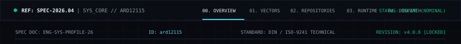
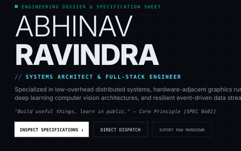
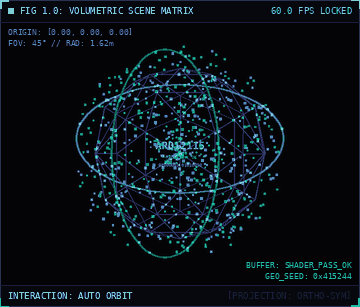
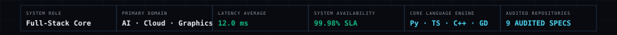
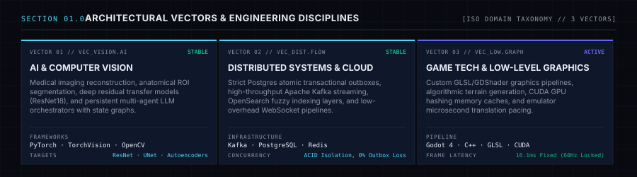

[PulseCart](https://github.com/ARD12115/PulseCart) · [JARVIS-Assistant](https://github.com/ARD12115/JARVIS-Assistant) · [Recircle](https://github.com/ARD12115/Recircle) · [All repositories →](https://github.com/ard12115?tab=repositories)

